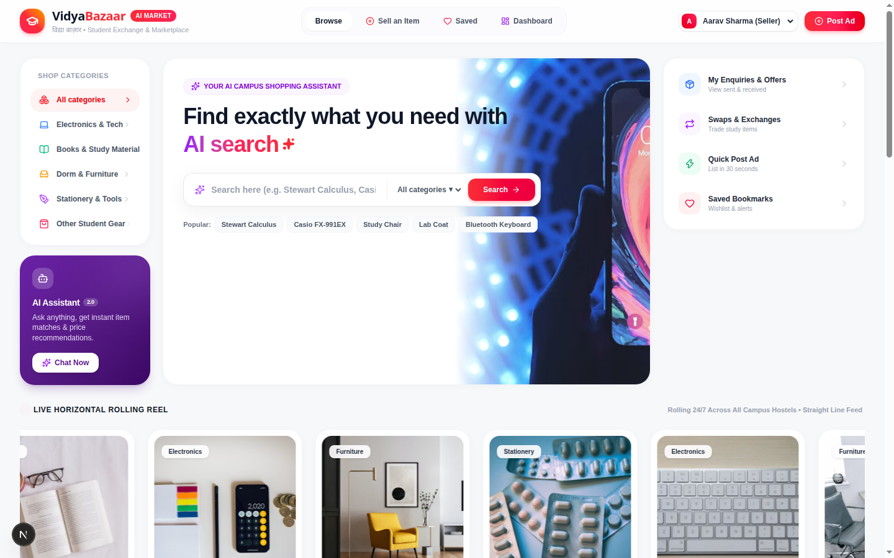
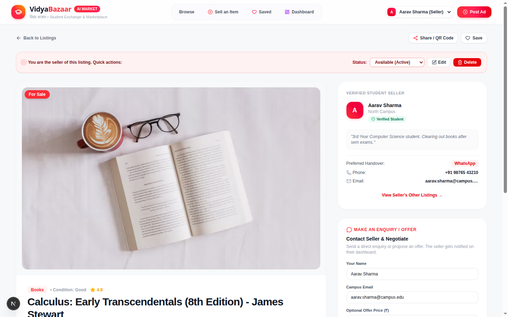
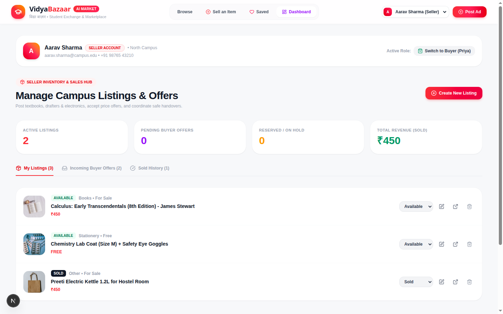
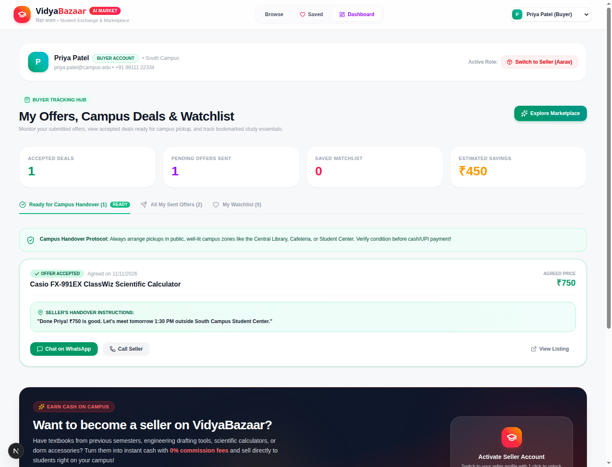
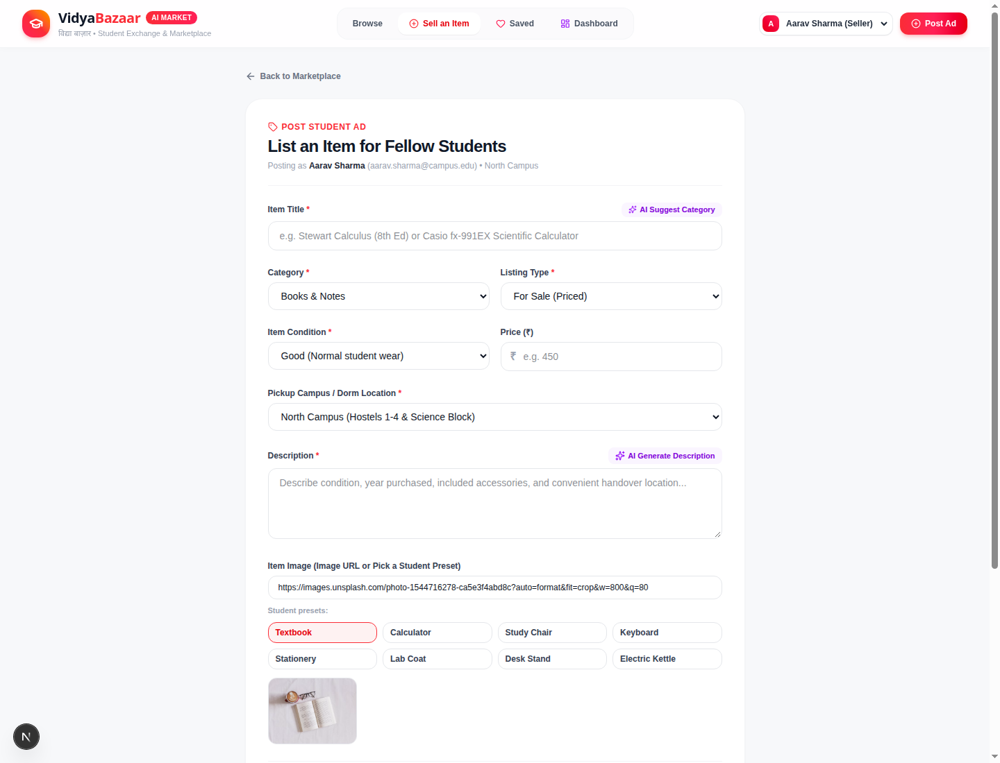
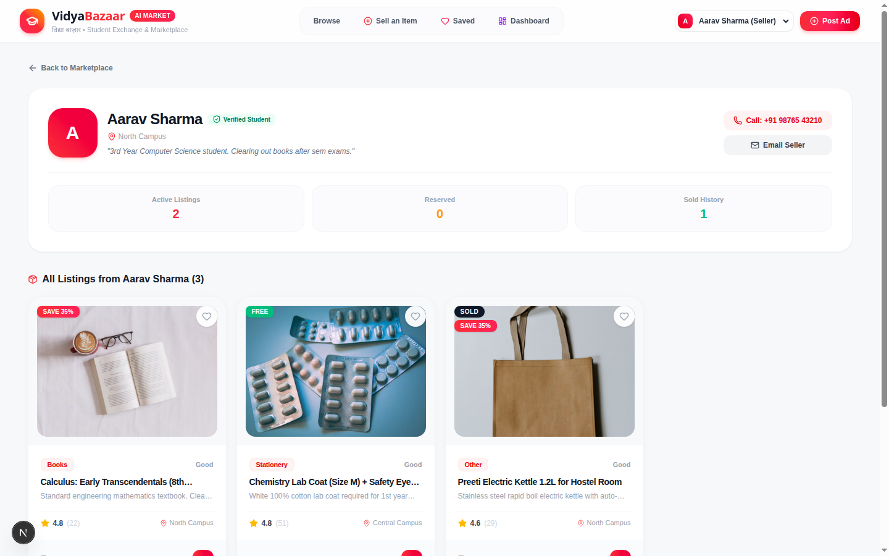
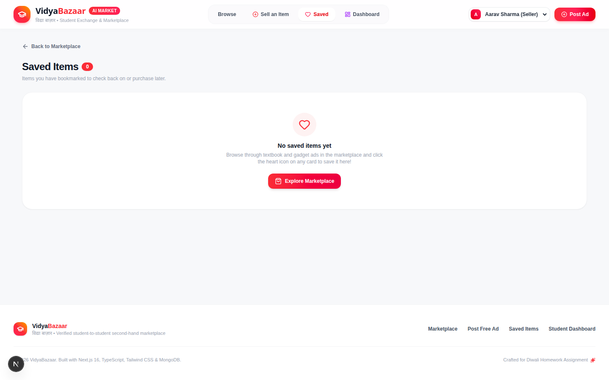
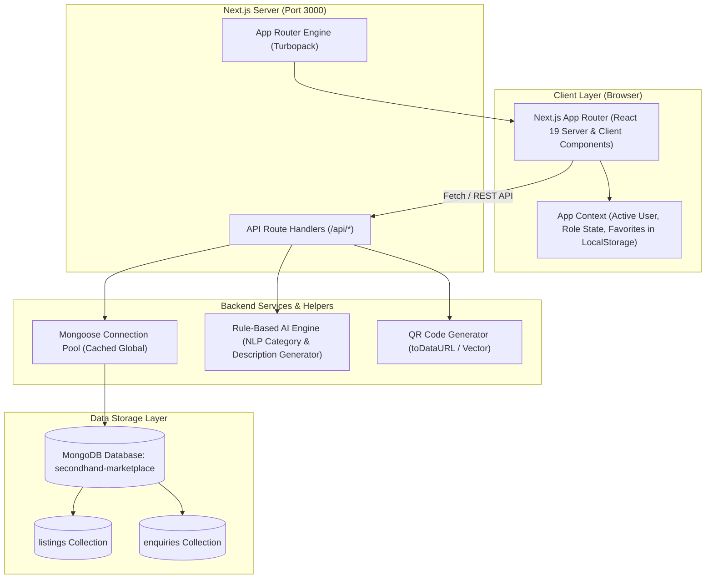
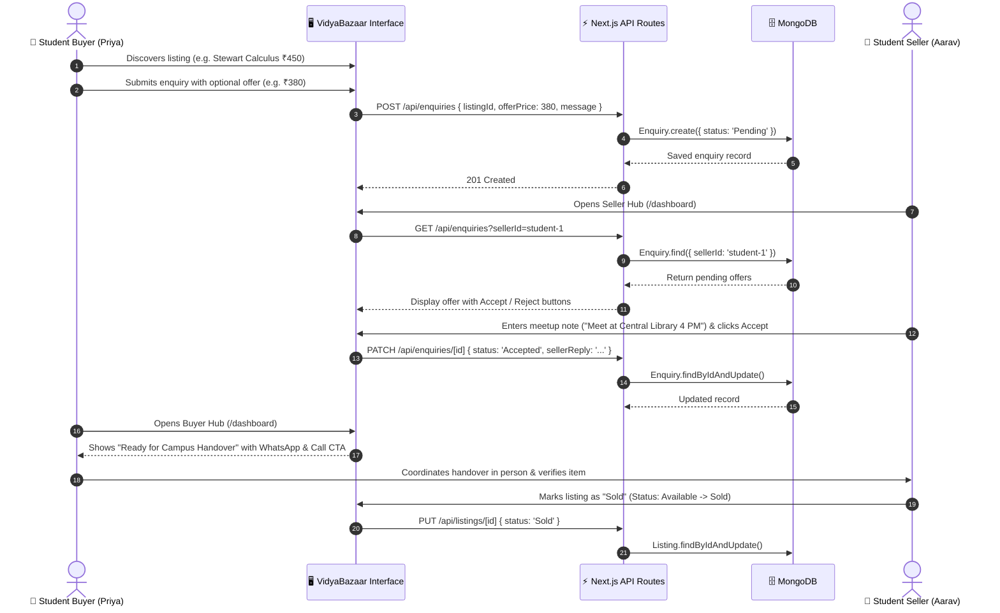
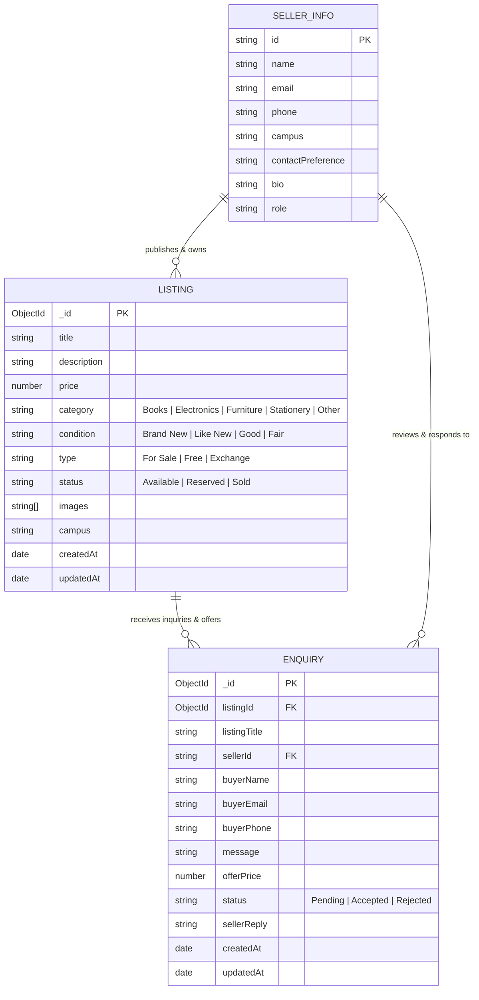

# 🎓 VidyaBazaar (विद्या बाज़ार)
### The Modern, Zero-Fee Second-Hand Marketplace for College Students

[](https://nextjs.org/)
[](https://react.dev/)
[](https://www.typescriptlang.org/)
[](https://tailwindcss.com/)
[](https://www.mongodb.com/)
[](https://mongoosejs.com/)
[](https://turbo.build/pack)
[](https://opensource.org/licenses/MIT)

---

## 📖 Table of Contents

- [Project Overview](#-project-overview)
- [Key Highlights & Differentiators](#-key-highlights--differentiators)
- [Visual Interface Showcase](#-visual-interface-showcase)
- [System Architecture](#-system-architecture)
  - [High-Level Component Architecture](#1-high-level-component-architecture)
  - [Buyer-Seller Negotiation & Handover Flow](#2-buyer-seller-negotiation--handover-flow)
  - [Entity Relationship Diagram](#3-entity-relationship-er-diagram)
- [Technology Stack](#-technology-stack)
- [Frontend Pages & Route Breakdown](#-frontend-pages--route-breakdown)
- [REST API Reference](#-rest-api-reference)
- [Database Models & Schemas](#-database-models--schemas)
- [Dedicated Demo Student Accounts](#-dedicated-demo-student-accounts)
- [Project Directory Structure](#-project-directory-structure)
- [Getting Started & Installation](#-getting-started--installation)
- [Environment Variables](#-environment-variables)
- [Key Application Workflows](#-key-application-workflows)
- [Campus Safety & Security](#-campus-safety--security)
- [Future Roadmap](#-future-roadmap)
- [Contributing](#-contributing)
- [License](#-license)

---

## 🌟 Project Overview

**VidyaBazaar (विद्या बाज़ार)** is a student-first second-hand exchange platform engineered specifically for university campuses. 

At the start of every college semester, students spend thousands of rupees on engineering mathematics textbooks, scientific calculators, laboratory coats, drafting boards, and dorm accessories that previous batches already own and no longer need. Meanwhile, senior students have unused study gear gathering dust in hostel rooms with no easy, zero-commission channel to pass them down.

VidyaBazaar solves this by providing:
1. **0% Platform Fees**: 100% of the sale goes directly to the student seller via UPI or cash upon physical handover.
2. **Dedicated Dual-Role Dashboards**: Strict separation between the **Seller Hub** (inventory, pending offers, sales revenue) and the **Buyer Hub** (accepted handovers, offer negotiations, and campus watchlist).
3. **AI-Assisted Listing Creation**: Instant title-to-category NLP classification and AI-crafted item descriptions tailored for college buyers.
4. **On-Campus Handover Coordination**: Structured offer negotiation where sellers can accept or counter with convenient campus meeting points (e.g., Central Library, Cafeteria, Hostel Gate).
5. **Noticeboard QR Codes**: One-click printable high-resolution QR codes to share listings across campus bulletin boards.

---

## ✨ Key Highlights & Differentiators

- **Zero-Friction Campus Discovery**: Instant keyword search, multi-criteria filtering (Category, Condition, Type, Price, Campus block), and sorting.
- **Continuous 24/7 Rolling Ticker**: High-contrast horizontal ticker displaying items across all campus blocks.
- **Interactive Bento Showcase**: Asymmetric visual bento grid spotlighting top campus deals, free junior giveaways, and tech essentials.
- **Structured Offer & Negotiation Engine**: Buyers submit structured price offers; sellers can accept, reject, or attach custom handover notes.
- **Real-Time Watchlist & Availability Alerts**: Automatically warns buyers if a bookmarked item has been reserved or purchased by another student.
- **Strict Role-Gated UI**: Buyer accounts never see clutter like "Sell an Item" or "Post Ad"; instead, a high-converting *"Want to become a seller?"* portal is provided.

---

## 📸 Visual Interface Showcase

### 1. Marketplace Discovery Hub
The main marketplace feed features a categorized sidebar, floating AI-assisted search, live continuous rolling reel, curated Bento gallery, and comprehensive listing filters.



---

### 2. Item Details & Offer Negotiation
Detailed view of used student items displaying seller verification, condition badges, campus location, printable QR code modal, and the structured price negotiation form.



---

### 3. Seller Management Hub
Dedicated to student sellers for real-time inventory management, price updates, incoming offer evaluations (Accept/Reject), and total revenue tracking.



---

### 4. Buyer Tracking Hub & Handover Coordination
Dedicated to student buyers to track submitted offers, coordinate physical campus handovers for accepted deals (WhatsApp/Call CTA), and monitor their campus watchlist.



---

### 5. AI-Powered Listing Creator
Enables sellers to post items in under 60 seconds using AI Category Detection and AI Listing Description generation.



---

### 6. Verified Student Seller Profile
Public profile exhibiting a student seller's active listings, verified campus status, preferred contact channels, and completed sales history.



---

### 7. Campus Watchlist & Availability Monitor
Tracks bookmarked items with real-time alerts if an item has been reserved or sold by the seller.



---

## 🏗️ System Architecture

### 1. High-Level Component Architecture



---

### 2. Buyer-Seller Negotiation & Handover Flow



---

### 3. Entity Relationship (ER) Diagram



---

## 💻 Technology Stack

| Layer | Technology | Version | Purpose |
| :--- | :--- | :--- | :--- |
| **Framework** | Next.js (App Router) | `16.4.6` | React server/client rendering, dynamic routing, API handlers |
| **Runtime UI** | React / React DOM | `19.3.0` | Concurrent UI rendering and state management |
| **Language** | TypeScript | `^5.0.0` | End-to-end static typing across models, API responses, and UI props |
| **Styling** | Tailwind CSS | `4.3.3` | Modern utility-first styling with responsive grid layouts |
| **Compiler** | Turbopack | Built-in | Sub-second local builds and lightning-fast HMR |
| **Database** | MongoDB | `7.0+` | NoSQL document storage for listings, enquiries, and profiles |
| **ODM** | Mongoose | `9.12.1` | Schema validation, connection caching, and query builders |
| **Icons** | Lucide React | `1.72.0` | 100% clean, professional vector SVG iconography |
| **Utilities** | qrcode | `1.5.4` | Client-side dynamic QR code generation for on-campus sharing |
| **Linting** | ESLint / Next ESLint | `9.x / 16.4.6` | Code style enforcement and syntax hygiene |

---

## 🗺️ Frontend Pages & Route Breakdown

Total Frontend Pages: **7 Routes**

| Route | File Path | Access / Role | Primary Features |
| :--- | :--- | :--- | :--- |
| `/` | `app/page.tsx` | All Users | Category sidebar, hero floating search, live continuous horizontal rolling reel, curated Bento gallery, full grid with multi-filtering, app promo mockup card, countdown deal timer, and Campus AI Assistant. |
| `/listings/[id]` | `app/listings/[id]/page.tsx` | All Users | High-res image gallery, price & condition badges, campus location, seller details card, printable QR code modal, structured price negotiation form, and similar items carousel. |
| `/listings/[id]/edit` | `app/listings/[id]/edit/page.tsx` | Seller Only | Edit title, price, category, condition, status (`Available` / `Reserved` / `Sold`), description, and campus location. |
| `/create` | `app/create/page.tsx` | Seller Only (Gated) | Seller-only listing creation with AI Category Auto-Detect, AI Description Generator, student image presets, campus location selector, and buyer upgrade guard. |
| `/dashboard` | `app/dashboard/page.tsx` | Dual (Role-Adaptive) | **Seller Hub**: Inventory management, status toggles, incoming offers (Accept/Reject), sales revenue.<br>**Buyer Hub**: Accepted deals (Ready for handover with WhatsApp/Call CTA), sent offers history, watchlist, and *"Want to become a seller?"* conversion section. |
| `/favorites` | `app/favorites/page.tsx` | All Users | Bookmarked items persisted in `localStorage` with real-time warnings if an item was marked `Reserved` or `Sold` by the seller. |
| `/seller/[id]` | `app/seller/[id]/page.tsx` | All Users | Verified student profile, campus location, contact preferences, active listings grid, and sold history. |

---

## 🔌 REST API Reference

Total API Route Handlers: **6 Files** • Total Verified HTTP Operations: **11 Endpoints**

### 1. Listings Module (`/api/listings`)

#### `GET /api/listings`
Fetch listings with comprehensive multi-criteria filtering and sorting.
- **Query Parameters**:
  - `search` (string): Keyword matching title or description (regex, case-insensitive).
  - `category` (string): `Books` \| `Electronics` \| `Furniture` \| `Stationery` \| `Other`.
  - `condition` (string): `Brand New` \| `Like New` \| `Good` \| `Fair`.
  - `type` (string): `For Sale` \| `Free` \| `Exchange`.
  - `status` (string): `Available` \| `Reserved` \| `Sold` \| `All`.
  - `campus` (string): `North Campus` \| `South Campus` \| `Central Campus` \| `East Campus`.
  - `minPrice` / `maxPrice` (number): Price range boundaries in ₹.
  - `sellerId` (string): Filter by specific seller ID.
  - `sort` (string): `newest` \| `price-asc` \| `price-desc`.
- **Response `200 OK`**:
  ```json
  {
    "success": true,
    "listings": [
      {
        "_id": "6af4654cab0b4e7d8a5ec1ed",
        "title": "Calculus: Early Transcendentals (8th Edition)",
        "price": 450,
        "category": "Books",
        "condition": "Good",
        "type": "For Sale",
        "status": "Available",
        "campus": "North Campus",
        "images": ["https://..."]
      }
    ]
  }
  ```

#### `POST /api/listings`
Publish a new second-hand item ad.
- **Request Body**:
  ```json
  {
    "title": "Casio FX-991EX ClassWiz Calculator",
    "description": "Like-new condition, exam approved.",
    "price": 850,
    "category": "Electronics",
    "condition": "Like New",
    "type": "For Sale",
    "status": "Available",
    "campus": "South Campus",
    "images": ["https://..."],
    "seller": {
      "id": "student-1",
      "name": "Aarav Sharma",
      "email": "aarav.sharma@campus.edu",
      "phone": "+91 98765 43210",
      "campus": "North Campus",
      "contactPreference": "WhatsApp"
    }
  }
  ```
- **Response `201 Created`**: Returns `{ success: true, listing: { ... } }`.

---

### 2. Single Listing Module (`/api/listings/[id]`)

#### `GET /api/listings/[id]`
Retrieve a single listing's full details and up to 3 similar items in the same category.
- **Response `200 OK`**:
  ```json
  {
    "success": true,
    "listing": { ... },
    "similar": [ ... ]
  }
  ```

#### `PUT /api/listings/[id]`
Update listing details, price, condition, or mark status as `Available`, `Reserved`, or `Sold`.
- **Response `200 OK`**: Returns `{ success: true, listing: { ... } }`.

#### `DELETE /api/listings/[id]`
Permanently delete a listing. Automatically cascades deletion of all associated enquiries.
- **Response `200 OK`**: Returns `{ success: true, message: "Listing deleted successfully" }`.

---

### 3. Enquiries & Offers Module (`/api/enquiries`)

#### `GET /api/enquiries`
Fetch enquiries filtered by `sellerId`, `buyerEmail`, or `listingId`.
- **Query Parameters**: `sellerId`, `buyerEmail`, `listingId`.
- **Response `200 OK`**: Returns `{ success: true, enquiries: [ ... ] }`.

#### `POST /api/enquiries`
Submit an enquiry with an optional negotiated offer price.
- **Request Body**:
  ```json
  {
    "listingId": "6af4654cab0b4e7d8a5ec1ed",
    "buyerName": "Priya Patel",
    "buyerEmail": "priya.patel@campus.edu",
    "buyerPhone": "+91 98111 22334",
    "message": "Can we meet at the Library? Would you take ₹380?",
    "offerPrice": 380
  }
  ```
- **Response `201 Created`**: Returns `{ success: true, enquiry: { ... } }`.

---

### 4. Enquiry Decision Module (`/api/enquiries/[id]`)

#### `PATCH /api/enquiries/[id]`
Accept or reject an offer and attach a seller reply or campus meeting instructions.
- **Request Body**:
  ```json
  {
    "status": "Accepted",
    "sellerReply": "Deal agreed! Let's meet at Central Library ground floor at 4 PM."
  }
  ```
- **Response `200 OK`**: Returns `{ success: true, enquiry: { ... } }`.

#### `DELETE /api/enquiries/[id]`
Delete an enquiry record.
- **Response `200 OK`**: Returns `{ success: true, message: "Enquiry deleted successfully" }`.

---

### 5. Utility & AI Modules

#### `POST /api/seed`
Clears existing database collections and seeds realistic college marketplace listings and sample negotiations.
- **Response `200 OK`**: Returns `{ success: true, count: 8 }`.

#### `POST /api/ai-helper`
Rule-based NLP categorizer and description generator.
- **Action 1: `suggest-category`**:
  - Request: `{ "action": "suggest-category", "title": "Calculus Early Transcendentals" }`
  - Response: `{ "success": true, "suggestedCategory": "Books" }`
- **Action 2: `generate-description`**:
  - Request: `{ "action": "generate-description", "title": "Casio Calculator", "category": "Electronics", "condition": "Like New" }`
  - Response: `{ "success": true, "generatedDescription": "..." }`

---

## 🗄️ Database Models & Schemas

### 1. `Listing` Model (`models/Listing.ts`)
```typescript
interface IListingDoc extends Document {
  title: string;
  description: string;
  price: number;
  category: "Books" | "Electronics" | "Furniture" | "Stationery" | "Other";
  condition: "Brand New" | "Like New" | "Good" | "Fair";
  type: "For Sale" | "Free" | "Exchange";
  status: "Available" | "Reserved" | "Sold";
  images: string[];
  campus: string;
  seller: {
    id: string;
    name: string;
    email: string;
    phone: string;
    campus: string;
    contactPreference: "Email" | "Phone" | "WhatsApp" | "Campus Meeting";
    bio?: string;
  };
  createdAt: Date;
  updatedAt: Date;
}
```

### 2. `Enquiry` Model (`models/Enquiry.ts`)
```typescript
interface IEnquiryDoc extends Document {
  listingId: mongoose.Types.ObjectId; // References Listing
  listingTitle: string;
  sellerId: string;
  buyerName: string;
  buyerEmail: string;
  buyerPhone?: string;
  message: string;
  offerPrice?: number;
  status: "Pending" | "Accepted" | "Rejected";
  sellerReply?: string;
  createdAt: Date;
  updatedAt: Date;
}
```

---

## 👥 Dedicated Demo Student Accounts

To test both sides of the marketplace without needing complex authentication setup, VidyaBazaar includes **two strictly isolated student profiles**:

| Account | Role | Student Details | Primary Features & Views |
| :--- | :--- | :--- | :--- |
| **Aarav Sharma** | `Seller` | 3rd Year Computer Science<br>North Campus • WhatsApp | • Has "+ Create New Listing" button<br>• Access to **Seller Hub** (/dashboard)<br>• Manage listings (`Available` ⇄ `Reserved` ⇄ `Sold`)<br>• Accept / Reject buyer price offers<br>• Sales history & total earned revenue |
| **Priya Patel** | `Buyer` | 2nd Year Electronics<br>South Campus • Meeting | • Zero selling options in Navbar or Mobile bar<br>• Access to **Buyer Hub** (/dashboard)<br>• **Ready for Campus Handover** view (WhatsApp & Call CTA)<br>• Negotiation history tracker<br>• Watchlist tracking with availability alerts<br>• *"Want to become a seller?"* conversion section |

*Users can easily toggle between Aarav and Priya from the persistent top navigation dropdown.*

---

## 📂 Project Directory Structure

```plaintext
next-js/
├── app/
│   ├── api/
│   │   ├── ai-helper/
│   │   │   └── route.ts          # NLP category suggester & description writer
│   │   ├── enquiries/
│   │   │   ├── [id]/
│   │   │   │   └── route.ts      # PATCH decision, DELETE enquiry
│   │   │   └── route.ts          # GET enquiries, POST new enquiry/offer
│   │   ├── listings/
│   │   │   ├── [id]/
│   │   │   │   └── route.ts      # GET single + similar, PUT edit, DELETE
│   │   │   └── route.ts          # GET filtered listings, POST create listing
│   │   └── seed/
│   │       └── route.ts          # POST seed realistic student dataset
│   ├── create/
│   │   └── page.tsx              # Create listing page (Seller-gated + AI tools)
│   ├── dashboard/
│   │   └── page.tsx              # Adaptive Seller Hub & Buyer Hub dashboard
│   ├── favorites/
│   │   └── page.tsx              # Saved items watchlist with stock warnings
│   ├── listings/
│   │   └── [id]/
│   │       ├── edit/
│   │       │   └── page.tsx      # Edit listing form
│   │       └── page.tsx          # Item details, QR modal & offer negotiation
│   ├── seller/
│   │   └── [id]/
│   │       └── page.tsx          # Public seller profile & listing history
│   ├── favicon.ico
│   ├── globals.css               # Tailwind CSS 4 directives & rolling reel styles
│   ├── layout.tsx                # Root layout with AppProvider, Navbar & Footer
│   └── page.tsx                  # Marketplace Home & Discovery Hub
├── components/
│   ├── Footer.tsx                # Clean student marketplace footer
│   ├── ListingCard.tsx           # Reusable product card with badges & stars
│   ├── Navbar.tsx                # Brand emblem, role-sensitive navigation & user switcher
│   └── QRCodeModal.tsx           # Printable campus noticeboard QR generator
├── context/
│   └── AppContext.tsx            # Global state (Current student user, role, favorites)
├── docs/
│   └── screenshots/              # High-resolution screenshots of actual app interface
├── lib/
│   └── mongodb.ts                # Cached MongoDB connection pool for Next.js HMR
├── models/
│   ├── Enquiry.ts                # Mongoose schema for inquiries & price offers
│   └── Listing.ts                # Mongoose schema for student product listings
├── types/
│   └── index.ts                  # Shared TypeScript interfaces & union types
├── .env.example                  # Safe environment variable template
├── .gitignore                    # Git ignore file excluding node_modules, .next, .env.local
├── eslint.config.mjs             # ESLint configuration
├── next.config.ts                # Next.js configuration
├── package.json                  # Dependencies & scripts
├── README.md                     # Comprehensive project documentation
└── tsconfig.json                 # TypeScript strict compiler configuration
```

---

## 🚀 Getting Started & Installation

### Prerequisites
- [Node.js](https://nodejs.org/) (`v18.18.0` or higher recommended; tested on `v20` and `v24`)
- [npm](https://www.npmjs.com/) or [yarn](https://yarnpkg.com/) / [pnpm](https://pnpm.io/)
- [MongoDB](https://www.mongodb.com/) running locally on port `27017` or a free MongoDB Atlas connection string.

### 1. Clone & Navigate
```bash
git clone https://github.com/theRkakkad/codinggita-sem-03-diwali_hw.git
cd "codinggita-sem-03-diwali_hw/next-js"
```

### 2. Install Dependencies
```bash
npm install
```

### 3. Configure Environment Variables
Create a `.env.local` file in the `next-js` directory (copy from `.env.example`):
```bash
cp .env.example .env.local
```
Set your MongoDB connection string:
```env
MONGODB_URI=mongodb://localhost:27017/secondhand-marketplace
```

### 4. Run the Development Server
```bash
npm run dev
```
Open [http://localhost:3000](http://localhost:3000) in your browser.

### 5. Populate Sample Student Data
To populate the database with realistic college items (calculators, textbooks, chairs, lab coats) and sample offers:
```bash
curl -X POST http://localhost:3000/api/seed
```
Or simply use the API endpoint to reset at any time.

---

## 🔒 Environment Variables

| Variable | Required | Default Value | Description |
| :--- | :---: | :--- | :--- |
| `MONGODB_URI` | **Yes** | `mongodb://localhost:27017/secondhand-marketplace` | MongoDB connection URI (local instance or MongoDB Atlas cluster) |

*A safe template is provided in [.env.example](.env.example).*

---

## 🔄 Key Application Workflows

### 1. The Seller Workflow (Publishing & Negotiation)
1. Switch to **Aarav Sharma (Seller)** in the top navigation bar.
2. Click **Sell an Item** or **Post Ad** (`/create`).
3. Type an item title (e.g., *"Engineering Mechanics Vol 1"*).
4. Click **Auto-Detect Category** — the rule-based AI selects `Books`.
5. Click **AI Generate Description** — an engaging student description is generated.
6. Submit the listing.
7. Open **Dashboard** (`/dashboard`). When buyers submit offers, review them under **Incoming Buyer Offers**, type meetup instructions, and click **Accept Offer**.

### 2. The Buyer Workflow (Discovery, Negotiation & Handover)
1. Switch to **Priya Patel (Buyer)** in the top navigation bar.
2. Notice that all selling options are removed from the navigation.
3. Browse listings using category pills, price sliders, or instant search.
4. Open an item (e.g., *Casio FX-991EX Calculator*).
5. Click **Make an Offer** and submit an offer price (e.g., ₹750) with a meetup inquiry.
6. Open **Dashboard** (`/dashboard`). Under the **Ready for Campus Handover** tab, view the seller's accepted response and click **Chat on WhatsApp** or **Call Seller** to finalize the exchange.

---

## 🛡️ Campus Safety & Security

- **Public Zone Handovers**: VidyaBazaar embeds campus safety guidelines encouraging students to conduct physical handovers in well-lit, public college locations (e.g., Central Library, Campus Cafeteria, or Main Academic Block).
- **No Online Payment Gateway Risk**: Eliminates payment processing fees, chargebacks, and payment fraud by facilitating direct student-to-student UPI or cash transactions upon item inspection.
- **Cascading Integrity**: Deleting a listing automatically purges related enquiries in MongoDB to prevent orphan records.
- **Sanitized Search**: Input queries in the search engine are trimmed and escaped to avoid injection vulnerabilities.

---

## 🗺️ Future Roadmap

- [ ] **College Email Domain Verification** (`.edu` / `.ac.in` OTP verification).
- [ ] **Hostel Block Filtering** (Filter specifically by Boys Hostel, Girls Hostel, or Off-Campus PG areas).
- [ ] **Book Barcode / ISBN Scanner** (Scan textbook barcode to autofill title, author, edition, and original MRP).
- [ ] **Semester Exchange Drives** (Batch exchange feature for end-of-semester textbook hand-me-downs).
- [ ] **PWA (Progressive Web App)** for native home-screen installation on student smartphones.

---

## 🤝 Contributing

Contributions are welcome! To contribute:
1. Fork the repository.
2. Create a feature branch (`git checkout -b feature/amazing-feature`).
3. Commit your changes (`git commit -m "Add amazing student feature"`).
4. Push to the branch (`git push origin feature/amazing-feature`).
5. Open a Pull Request.

---

## 📄 License

This project is licensed under the **MIT License**. Feel free to use, modify, and distribute this codebase for educational and college project purposes.

---

<div align="center">
  <sub>Crafted with ❤️ for the Diwali Homework Assignment • Built with Next.js 16, TypeScript, Tailwind CSS & MongoDB.</sub>
</div>
